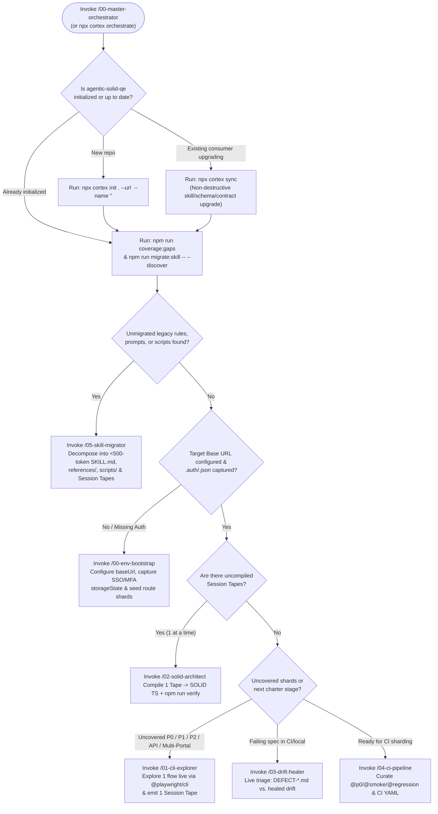

# Master Orchestration Playbook & 5-Stage Incremental Coverage Guide

> **Purpose:** Complete reference for `/00-master-orchestrator` (`/master-orchestrator`) so human Quality Engineers and AI Agents (**Google Antigravity, Claude Code, GitHub Copilot, Cursor, Windsurf**) can understand every skill, contract, CLI gate, onboarding track, and incremental coverage stage in `agentic-solid-qe`.

---

## 1. Interactive Decision Tree: Where Should We Start?



---

## 2. Complete Framework Capability Catalog

### 2.1 The 7 Skills (`.agents/skills/`)

| Skill ID | Slash Command | Primary Responsibility | Backing CLI / Gate |
| :--- | :--- | :--- | :--- |
| **`00-master-orchestrator`** | `/00-master-orchestrator` or `/master-orchestrator` | **Entry Point & Advisor:** Runs live diagnostics, explains all framework features, selects the right Onboarding Track (1–4), and guides incremental coverage across Stages 0–4. | `npx cortex orchestrate` / `npm run coverage:gaps` |
| **`00-env-bootstrap`** | `/00-env-bootstrap` | **Environment & Auth Bootstrap:** Sets `baseUrl`, captures reusable `.auth/<persona>.json` (`storageState`) for SSO/MFA apps, and seeds top-level feature shards in `.agents/domain/domain-memory.md`. | `npm run init:app` |
| **`01-cli-explorer`** | `/01-cli-explorer` | **Autonomous Explorer & Coverage Curator:** Explores unfamiliar UI flows and backend APIs via `npx playwright-cli -s=<session> --headed`, checks multi-oracle heuristics (network, console, storage, a11y), logs bugs to `defects/`, and emits 1 validated `.exploratory/tapes/<scenario>.json` at a time. | `npm run coverage:gaps` & `npm run validate:tapes` |
| **`02-solid-architect`** | `/02-solid-architect` | **SOLID TypeScript Compiler:** Compiles 1 Session Tape at a time into `src/contracts/`, `src/components/` (`≤ 150` lines, zero `expect()`), `src/pages/`, `src/domains/<squad>/`, `src/data/` Builders, `src/fixtures/`, and declarative `tests/*.spec.ts`. | `npm run verify` |
| **`03-drift-healer`** | `/03-drift-healer` | **Live Failure Triage & Self-Healing:** Replays failing `.spec.ts` routes via `@playwright/cli` to separate genuine application regressions (`defects/DEFECT-*.md`) from UI locator, wizard condition, API contract, or auth drift. | `npx playwright test` |
| **`04-ci-pipeline`** | `/04-ci-pipeline` | **CI/CD & Tag Architect:** Curates `@p0`, `@smoke`, `@regression`, and `@api-contract` tags, hardens `playwright.config.ts`, and scaffolds sharded GitHub Actions and Azure DevOps pipelines. | `npm run audit:solid` |
| **`05-skill-migrator`** | `/05-skill-migrator` | **Legacy Skill & Script Migrator:** Discovers and decomposes `.cursorrules`, `CLAUDE.md`, custom prompts, and `.sh`/`.js`/`.ts`/`.py` scripts into `< 500`-token `SKILL.md` bundles, secret-redacted `references/` & `scripts/`, Session Tapes, and `≤ 150`-line Domain Shards. | `npm run migrate:skill` |

### 2.2 Built-In Enterprise SOLID Contracts & Shared Utilities (`src/`)

| Contract / Utility | File Path | Purpose |
| :--- | :--- | :--- |
| **`IdentifiableComponent`** | `src/contracts/identifiable-component.contract.ts` | Liskov Substitution (LSP) root contract (`readonly root: Locator`) required on all UI components (`≤ 150` lines, zero `expect()`). |
| **`ErrorBannerContract`** | `src/contracts/error-banner.contract.ts` | Standardized validation/alert banner contract (`readonly errorBanner: Locator`, `dismissError()`). |
| **`WizardStepContract<T>`** | `src/contracts/wizard-step.contract.ts` | Contract for 5–12 step conditional wizards (`isApplicable(profile)`, `fillStep(profile)`, `advance()`, `stepHeading`). |
| **`ApiClientContract`** | `src/contracts/api-client.contract.ts` | Contract for typed `APIRequestContext` backend clients returning `ApiResponseEnvelope<T>` (zero `expect()` inside client classes). |
| **`AuthTokenBridge`** | `src/shared/api/auth-token.bridge.ts` | Extracts Bearer tokens or session cookies from `.auth/<persona>.json` (`storageState`) to authenticate backend `APIRequestContext` calls without re-logging in via UI. |
| **`RelativeDateHelper`** | `src/shared/data/relative-date.helper.ts` | Generates deterministic relative ISO/formatted dates (`daysFromToday`, `yearsAgo`) in Data Builders so tests never rot on hardcoded calendar dates. |

---

## 3. The 5-Stage Incremental Coverage Progression Playbook

Never attempt to automate an entire application in a single unverified batch. Use `/00-master-orchestrator` to advance your repository through five deterministic stages **1 test at a time**:

### Stage 0: Foundation, Auth & Legacy Onboarding
- **Goal:** Establish a clean SOLID skeleton, migrate pre-existing team prompts/scripts, configure target `baseUrl`, capture persona `storageState`, and map top-level routes into Domain Shards.
- **Actions:**
  1. New repo: `npx --yes github:letstrnsfrm-ai/agentic-solid-qe init . --url <url> --name "<App>"` (or `npx cortex sync` for existing consumers).
  2. Discover & migrate legacy prompts/scripts: `npm run migrate:skill -- --discover` ➔ `/05-skill-migrator`.
  3. Bootstrap auth & route shards: `/00-env-bootstrap`.
- **Exit Criteria:** `.agents/domain/domain-memory.md` has a valid `Base URL`, `.auth/<persona>.json` is captured (if authenticated), and initial `.agents/domain/shards/*.md` files are indexed (`npm run domain:graph`).

### Stage 1: P0 Golden-Path Baseline (`@p0` — 1 Test at a Time)
- **Goal:** Cover every core business shard in `uncoveredShards` with 1 high-value `@p0` happy-path vertical slice before writing edge cases.
- **Actions (Repeat 1 Shard at a Time):**
  1. Run `/01-cli-explorer` with charter `happy-path-baseline` on the first uncovered shard (`nextSingleScenarioToAutomate`).
  2. Approve 1 scenario from the **Session Debrief & Coverage Selection Matrix** to emit `.exploratory/tapes/<scenario-id>.json`.
  3. Run `/02-solid-architect <scenario-id>` to compile atomic components, page objects, builders, fixtures, and 1 `@p0` `.spec.ts` file.
  4. Run `npm run verify` until 100% green.
- **Exit Criteria:** `uncoveredShards.length === 0` and `uncompiledTapes.length === 0` in `npm run coverage:gaps`, and `npm run test:p0` passes.

### Stage 2: Multi-Persona, Boundary & Resilience Expansion (`@smoke` & `@regression`)
- **Goal:** Deepen coverage on existing Pages and Components without duplicating page objects.
- **Actions (1 Scenario at a Time):**
  1. **Role & Access Control (`multi-persona-auth`):** Explore locked-out, unauthorized, or role-restricted personas via `/01-cli-explorer` and compile via `/02-solid-architect`.
  2. **Validation & Field Boundaries (`boundary-analysis`):** Explore inline error banners (`ErrorBannerContract`), empty/malformed inputs, and business rule limits.
  3. **State Persistence & A11y (`state-interruption` & `accessibility-audit`):** Verify reload/back-navigation cart/wizard state retention and WCAG landmarks/labels.
- **Exit Criteria:** Every core shard has both positive (`@p0`) and negative/persona/boundary (`@smoke`, `@regression`) test coverage reusing the same `src/components/` and `src/data/*.builder.ts` classes.

### Stage 3: Enterprise Wizards, Backend API Seeding & Cross-Portal Handoffs
- **Goal:** Scale to complex multi-squad workflows, 5–12 step conditional wizards, backend API contracts, and multi-portal actor handoffs (see `.agents/skills/02-solid-architect/references/complex-orchestration-guide.md`).
- **Actions (1 Scenario at a Time):**
  1. **Multi-Squad Partitioning (if multiple teams):** Run `npx cortex sync --squad <squad-name>` to isolate `.agents/domain/domains/<squad>/` and `src/domains/<squad>/`.
  2. **Pattern A — Conditional Wizards (`WizardStepContract`):** Model each wizard step as `src/domains/<squad>/steps/<step>.step.ts` (`≤ 150` lines) driven by typed risk profiles (`RelativeDateHelper`).
  3. **Pattern B — Backend API Clients (`ApiClientContract` + `AuthTokenBridge`):** Capture `networkContracts` in `/01-cli-explorer` (`charter: "api-contract"`) and compile `src/domains/<squad>/api/*.client.ts` for fast API precondition seeding and `@api-contract` tests (`npm run test:api`).
  4. **Pattern C — Cross-Portal Handoffs (`cross-portal-handoff`):** Orchestrate Customer Portal (`actor: "customer"`) ➔ `capturedVariables` (`QuoteId`) ➔ Back-Office Agent Portal (`actor: "underwriter_agent"`) using isolated `BrowserContext`s.
- **Exit Criteria:** Complex wizard steps, API clients (`unimplementedApiClients.length === 0`), and multi-portal handoffs pass `npm run verify`.

### Stage 4: Sharded CI/CD Execution & Continuous Day-2 Drift Healing
- **Goal:** Run fast, reliable quality gates in CI/CD and heal application evolution without manual maintenance bottlenecks.
- **Actions:**
  1. Invoke `/04-ci-pipeline` to audit `@p0`/`@smoke`/`@regression` tag distribution and configure sharded GitHub Actions (`.github/workflows/playwright-ci.yml`) or Azure DevOps (`.azure-pipelines/playwright-ci.yml`).
  2. When a test fails locally or in CI, invoke `/03-drift-healer` to inspect the live route via `@playwright/cli`:
     - **Real App Bug:** Automatically logs `defects/DEFECT-<timestamp>-<slug>.md` with reproduction evidence and leaves the failing assertion intact.
     - **Harmless UI/API/Wizard Drift:** Updates only the affected Component locator, WizardStep condition, API Client endpoint, or Domain Shard `**Last Verified:**` date, then verifies with `npm run verify`.
- **Exit Criteria:** `staleShards.length === 0`, all specs carry execution tags, and `npm run verify` runs green in sharded CI.

---

## 4. Output Template: Project Maturity & Next-Action Blueprint

Whenever `/00-master-orchestrator` runs, present this concise summary to the user:

```markdown
### 🧠 Agentic-SOLID-QE — Master Orchestrator Blueprint

- **Target Application:** `<appName>` (`<baseUrl>`)
- **Recommended Onboarding Track:** `<Track 1 | Track 2 | Track 3 | Track 4>`
- **Current Coverage Maturity Stage:** `<Stage 0..4 — Stage Name>`
- **Repository Health Snapshot:**
  - **Domain Brain:** `<N>` Hub(s), `<M>` Feature Shard(s) (`<U>` uncovered, `<S>` stale)
  - **Session Tapes:** `<T>` recorded (`<P>` uncompiled)
  - **SOLID Suite:** `<C>` Components, `<W>` Wizard Steps, `<G>` Pages, `<A>` API Clients, `<B>` Data Builders, `<X>` Specs
  - **Legacy Artifacts Discovered:** `<L>` unmigrated prompts/skills/scripts, `<D>` open defects

#### 🎯 Recommended Next Step (1 Test at a Time)
1. **Primary Action:** `<Exact /skill or npx cortex command>`
2. **Why Now:** `<1-sentence explanation tied to current maturity stage>`
3. **Next Incremental Milestone:** `<What unlocks after this step passes npm run verify>`
```
