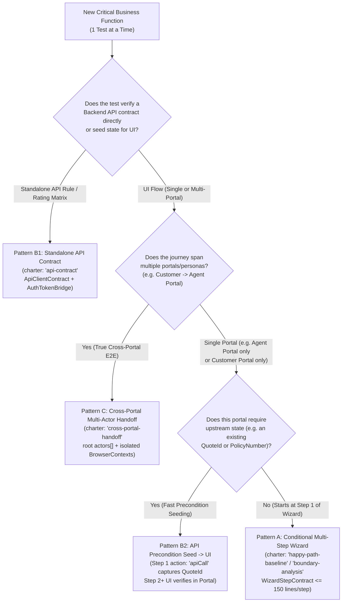

# Complex Application, Multi-Portal & Backend API Orchestration Guide

> **Audience:** AI Coding Agents (**Google Antigravity, Claude Code, GitHub Copilot, Cursor, Windsurf**) and Quality Engineers building or upgrading automation coverage **1 test at a time** across multi-step wizards (e.g., Motor/Home Insurance), Back-Office Agent/Underwriting portals, and Backend APIs.

---

## 1. Agent Orchestration Decision Tree (Which Pattern to Use?)

When a user asks you to explore or automate a business flow, classify the scenario using this decision tree before emitting a Session Tape (`.exploratory/tapes/<scenario-id>.json`) or generating TypeScript in `src/`:



---

## 2. Strict "1-Test-at-a-Time" Vertical Slice Protocol

Never batch-generate 10 unverified specs at once on complex applications. Execute this closed loop **one critical business scenario at a time**:

1. **Step 1 — Inspect Coverage & Select Next Vertical Slice:**
   ```bash
   npm run coverage:gaps
   ```
   - Read `nextSingleScenarioToAutomate` from the JSON output and inspect `.agents/domain/domain-memory.md` + the target squad hub (`.agents/domain/domains/<squad>/index.md`).
2. **Step 2 — Explore 1 Scenario & Its Backend APIs (`/01-cli-explorer`):**
   - Traverse the flow via `npx playwright-cli -s=<session> open <baseUrl> --headed`.
   - Record every wizard step (`componentCandidate`, `conditionRef`), runtime identifier (`capturedVariables`), and backend API call (`networkContracts` with `clientCandidate` and `responseSchemaSummary`).
   - Emit **1 Session Tape** (`.exploratory/tapes/<scenario-id>.json`) and validate it:
     ```bash
     npm run validate:tapes
     ```
3. **Step 3 — Compile & Verify That Single Scenario (`/02-solid-architect <scenario-id>`):**
   - Reuse existing `src/domains/<squad>/{api,components,pages,data,fixtures}/` classes before scaffolding new ones.
   - Run the full verification gate until 100% green before moving to the next scenario:
     ```bash
     npm run verify
     ```

---

## 3. Canonical Session Tape & SOLID Blueprints for the 4 Patterns

### Pattern A: Multi-Step Conditional Wizards (5–12 Steps, e.g., Motor/Home Quote)

When automating long questionnaires where steps appear conditionally based on risk data (e.g., prior claims, convictions, flat roof, non-standard construction):
- **Session Tape (`semanticSteps[].conditionRef`):**
  ```json
  {
    "stepIndex": 4,
    "intent": "Fill prior motor claim date when driver has claims history",
    "pageRoute": "/quote/claims-history",
    "conditionRef": "MotorRiskBuilder.driverWithPriorClaim().hasPriorClaims",
    "action": "fill",
    "inputDataRef": "MotorRiskBuilder.driverWithPriorClaim().priorClaimDate",
    "componentCandidate": "ClaimsHistoryStepComponent",
    "locatorContract": {
      "parentScope": { "strategy": "getByRole", "role": "region", "value": "Claims History" },
      "strategy": "getByLabel",
      "value": "Date of Incident"
    }
  }
  ```
- **SOLID Implementation:**
  - Each wizard section is an atomic `≤ 150`-line component implementing `WizardStepContract<TRiskProfile>` (`@contracts/wizard-step.contract`).
  - Dynamic dates (`policyStartDate`, `driverDob`, `priorClaimDate`) are computed at runtime via `RelativeDateHelper` (`@shared/data/relative-date.helper`).

---

### Pattern B: Backend API Exploration, Fast Precondition Seeding & API Contract Specs

Instead of driving a 12-step Customer UI wizard every time you want to test a Back-Office Agent Portal function (like Mid-Term Adjustment, Cancellation, or Referral Approval), seed the Quote/Policy via API in Step 1:

- **Session Tape (`action: "apiCall"` + `source: "apiResponseJson"`):**
  ```json
  {
    "capturedVariables": [
      {
        "name": "seededQuoteId",
        "capturedAtStep": 1,
        "source": "apiResponseJson",
        "jsonPath": "data.quoteId",
        "description": "Referred Quote ID created via Backend Rating API"
      }
    ],
    "semanticSteps": [
      {
        "stepIndex": 1,
        "intent": "Seed a referred Motor Quote via Backend API",
        "action": "apiCall",
        "inputDataRef": "MotorRiskBuilder.referredHighPerformanceQuote()",
        "capturesVariable": "seededQuoteId",
        "componentCandidate": "MotorQuoteApiClient",
        "locatorContract": {
          "strategy": "apiEndpoint",
          "value": "/api/v1/quotes"
        }
      },
      {
        "stepIndex": 2,
        "intent": "Search for seeded Quote ID in Back-Office Agent Portal",
        "pageRoute": "/agent/referrals",
        "action": "fill",
        "inputDataRef": "MotorRiskBuilder.referredHighPerformanceQuote().lookupRef",
        "componentCandidate": "ReferralSearchComponent",
        "locatorContract": {
          "strategy": "getByLabel",
          "value": "Quote Reference"
        }
      }
    ]
  }
  ```
- **SOLID Implementation:**
  - Generate `src/domains/<squad>/api/<name>.client.ts` implementing `ApiClientContract` (`@contracts/api-client.contract`) with **zero `expect()` calls**.
  - Use `AuthTokenBridge.extractAuthHeaders('.auth/<persona>.json')` (`@shared/api/auth-token.bridge`) to automatically inject SSO Bearer tokens or cookies captured by `/00-env-bootstrap`.

---

### Pattern C: Cross-Portal Multi-Actor Handoffs (`Customer Portal` ➔ `Back-Office Agent Portal`)

When a critical P0 test must prove the full UI-to-UI handoff across two distinct portals and personas:
- **Session Tape (`charter: "cross-portal-handoff"` + `actors[]`):**
  ```json
  {
    "schemaVersion": "1.0.0",
    "scenarioId": "motor-referral-customer-to-agent-bind",
    "title": "Customer triggers underwriting referral on B2C Portal and Underwriter approves in Agent Portal",
    "charter": "cross-portal-handoff",
    "tags": ["@p0", "@smoke", "@cross-portal"],
    "recordedAt": "2026-11-14T00:00:00.000Z",
    "baseUrl": "https://quote.insurer.example.com",
    "apiBaseUrl": "https://api.insurer.example.com",
    "persona": {
      "role": "customer_anonymous",
      "dataBuilderRef": "MotorRiskBuilder.referredDriverPersona()"
    },
    "actors": [
      {
        "actorId": "customer",
        "role": "customer_anonymous",
        "portalBaseUrl": "https://quote.insurer.example.com",
        "dataBuilderRef": "MotorRiskBuilder.referredDriverPersona()"
      },
      {
        "actorId": "underwriter_agent",
        "role": "senior_underwriter",
        "portalBaseUrl": "https://agent-portal.insurer.example.com",
        "dataBuilderRef": "UserBuilder.seniorUnderwriter()",
        "storageStatePath": ".auth/senior_underwriter.json"
      }
    ],
    "preconditions": [
      "Senior Underwriter SSO storageState exists at .auth/senior_underwriter.json"
    ],
    "capturedVariables": [
      {
        "name": "referralQuoteId",
        "capturedAtStep": 1,
        "source": "textContent",
        "description": "Quote Reference displayed on Customer Referral Banner"
      }
    ],
    "semanticSteps": [
      {
        "stepIndex": 1,
        "actor": "customer",
        "intent": "Submit high-risk quote and capture generated Referral Quote ID",
        "pageRoute": "/quote/summary",
        "action": "click",
        "capturesVariable": "referralQuoteId",
        "componentCandidate": "QuoteReferralBannerComponent",
        "locatorContract": {
          "strategy": "getByTestId",
          "value": "referral-quote-reference"
        }
      },
      {
        "stepIndex": 2,
        "actor": "underwriter_agent",
        "portalUrl": "https://agent-portal.insurer.example.com",
        "intent": "Open Back-Office Agent Referral Queue and approve referred quote",
        "pageRoute": "/underwriting/referrals",
        "action": "click",
        "componentCandidate": "AgentReferralQueueComponent",
        "locatorContract": {
          "strategy": "getByRole",
          "role": "button",
          "value": "Approve Referral"
        }
      }
    ],
    "networkContracts": [
      {
        "urlPattern": "/api/v1/underwriting/referrals/*/approve",
        "method": "POST",
        "expectedStatus": 200,
        "clientCandidate": "UnderwritingReferralApiClient",
        "responseSchemaSummary": "{ quoteId: string, status: 'APPROVED', boundPolicyNumber: string }"
      }
    ],
    "expectedStates": [
      {
        "description": "Agent Portal displays Approved status for the Customer's referred Quote ID",
        "actor": "underwriter_agent",
        "assertionType": "toContainText",
        "targetComponent": "agentReferralPage.queue",
        "targetProperty": "approvedQuoteBadge",
        "expectedValueRef": "capturedVariable:referralQuoteId"
      }
    ]
  }
  ```

---

## 4. Upgrading Existing Day-to-Day Consumer Repositories Non-Destructively

Teams that already have `agentic-solid-qe` enabled in their repositories receive all Multi-Portal, Conditional Wizard, and Backend API capabilities **without breaking a single existing test, domain shard, or fixture**:

1. **Run the Non-Destructive Sync Command:**
   ```bash
   npx --yes github:letstrnsfrm-ai/agentic-solid-qe sync
   ```
   *(Or `npm run upgrade:skills` / `npm run sync:skills`)*
2. **What `sync` Updates Automatically vs. Preserves:**
   - **Updated (`overwrite: true`):**
     - `.agents/skills/00-env-bootstrap` through `05-skill-migrator` (including this guide and updated SOLID patterns)
     - `.agents/domain/session-tape.schema.json`
     - `scripts/{build-domain-graph,migrate-skill,analyze-coverage,audit-solid,validate-tapes,sync-skills}.mjs`
     - `AGENTS.md`, `.github/copilot-instructions.md`, `.github/prompts/*`, `.claude/commands/*` (any custom pre-existing `AGENTS.md` is backed up to `.agents/legacy-backups/`)
   - **Seeded Only If Missing (`overwrite: false`):**
     - `src/contracts/api-client.contract.ts` & `src/contracts/wizard-step.contract.ts`
     - `src/shared/api/auth-token.bridge.ts` & `src/shared/data/relative-date.helper.ts`
   - **Merged Non-Destructively:**
     - `tsconfig.json` (`@domains/*` and `@shared/*` path aliases added if missing)
     - `package.json` (`verify`, `domain:graph`, `coverage:gaps`, `audit:solid`, `validate:tapes`, `upgrade:skills` scripts merged without removing custom scripts)
   - **100% Preserved (Never Touched by `sync`):**
     - `.agents/domain/domain-memory.md`, `.agents/domain/shards/*.md`, `.agents/domain/domains/**`
     - `.exploratory/tapes/*.json`, `defects/*.md`
     - Existing `src/components/**`, `src/pages/**`, `src/data/**`, `src/fixtures/**`, `src/domains/**`, and `tests/**/*.spec.ts`
3. **Optionally Partition into Domain Squads When Ready:**
   ```bash
   npx cortex sync --squad motor-b2c
   npx cortex sync --squad home-b2c
   npx cortex sync --squad agent-portal
   npm run verify
   ```
