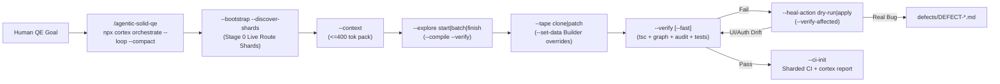

# Agentic-SOLID-QE (`agentic-solid-qe` · CLI: `cortex` / `asqe`)

> **Zero-API-key, token-efficient agent skill framework** bridging **Autonomous Live Exploration** (`agent-browser` + `cortex explore`), **Deterministic SOLID Playwright TypeScript Compilation** (`cortex compile`), **Live Drift Healing** (`cortex heal`), and **2,000-Test Enterprise Java/C# Legacy Migration** (`cortex wave`).
>
> Works natively across **Antigravity, Claude Code, GitHub Copilot, Cursor, and Windsurf** · **MIT Licensed** · **Current Release: `v0.47.1`**

---

## Why `agentic-solid-qe`?

| Problem in Ad-Hoc AI Test Automation | `agentic-solid-qe` (`v0.47.1`) Solution |
| :--- | :--- |
| **Token Burn & Context Rot** (monolithic prompts, noisy DOM dumps, 10+ file-read turns) | **5-Pillar Token Efficiency:** `AGENTS.md` (528 tok), `≤ 500`-tok `SKILL.md`, `≤ 800`-tok topic references, `≤ 400`-tok single-call `cortex context` packs, `cortex tape` CLI, pruned `-i` browser deltas, and failure-only `verify:fast` reporting. |
| **Brittle, Unmaintainable Generated Specs** (inline selectors, `waitForTimeout`, `expect()` everywhere) | **Deterministic SOLID Compiler (`cortex compile`):** Enforces `≤ 150`-line SRP Components (`IdentifiableComponent`, `WizardStepContract`, `StateSeederContract`, `FlowContract`), zero `expect()` in `src/`, Data Builders (DIP), and business-domain `test.step()`. |
| **Slow Re-Exploration of Deep Flows** | **Resume-First `cortex explore`:** Reuses existing specs (`--from-spec`), `<1s` browser checkpoints (`--checkpoint`), or API seeders (`--from-seed`) with batched actions and `--compile --verify --emit-seeder`. |
| **Flaky CI vs. Real Bugs** | **Differential `cortex heal`:** Replays failing routes live to distinguish **Genuine Regressions** (drafting secret-redacted `defects/DEFECT-*.md` without weakening assertions) from **Safe Locator/Auth Drift** with 3-Layer Shared-Module Blast-Radius Protection. |
| **2,000+ Legacy Selenium / RestAssured / .NET Tests** | **Squad Wave Factory (`cortex wave`):** Multi-`.csproj`/Maven squad analyzer, Wave-0 Seeder/Flow rationalization, autonomous `--run --verify` micro-batches, and HTML N:1 Parity Dashboard. |

---

## Measured Token-Efficiency Benchmarks (`v0.47.1`)

Measured with the deterministic token estimator shared by [`audit:solid`](scripts/audit-solid.mjs) and [`scripts/lib/cli-output.mjs`](scripts/lib/cli-output.mjs):

| Surface | Before | `v0.47.1` | Reduction |
| :--- | ---: | ---: | ---: |
| `AGENTS.md` *(injected on every turn)* | 2,477 tok | **528 tok** | **-78.7%** |
| `.github/copilot-instructions.md` *(zero eager reference preloads)* | 922 tok | **460 tok** | **-50.1%** |
| Worst-case `references/*.md` topic load | 4,019 tok | **774 tok** *(avg 602 tok across 23 chunks)* | **-80.7%** |
| `cortex orchestrate` *(auto-compact in agent shells)* | 249 tok (17L) | **107 tok (5L)** | **-57.0%** |
| `cortex gaps --compact` | 1,883 tok (242L) | **97 tok (4L)** | **-94.8%** |
| `cortex compile --compact` *(dry-run)* | 773 tok (118L) | **47 tok (3L)** | **-93.9%** |
| `cortex heal` *(auto-compact triage card)* | 158 tok (25L) | **22 tok (2L)** | **-86.1%** |
| Multi-file context read (`domain-memory` + `graph` + shard + tape + `src/`) | ~5,900 tok (5–8 turns) | **286–398 tok in 1 call** (`cortex context`) | **-93% to -95%** |
| Session Tape inspection & variant cloning (raw JSON + schema) | ~6,206 tok | **42 tok (`list`) / 454 tok (`show`)** + 1-call `clone`/`patch` | **-92.7%** |
| `npm run verify:fast` *(pass)* | verbose stream | **27 tok (1L)** *(zero-ANSI failure excerpts on fail)* | **~90%+** |

---

## Autonomous Closed-Loop QE Lifecycle

**Operating Model:** **Human = Direction & Review** (states QE goals, approves scenario/triage/PR gates, completes interactive MFA/CAPTCHA). **Agent = Autonomous Executor** (routes all commands and structured `GATE_OPTIONS` questions through `npx cortex orchestrate`).



---

## 5-Minute Quick Start

### 1. Install Into Any Existing or New Repository (Non-Destructive)

```bash
# Requires Node.js >= 20.12.0
npx --yes github:letstrnsfrm-ai/agentic-solid-qe#v0.47.1 init . \
  --url https://your-app-url.com \
  --name "Your App"

npm install
npx playwright install chromium
npx cortex orchestrate --bootstrap --discover-shards
```

- **Non-destructive:** Merges `package.json` scripts & `bin.cortex`, `tsconfig.json` path aliases (`@contracts/*`, `@components/*`, `@pages/*`, `@data/*`, `@fixtures/*`, `@domains/*`, `@shared/*`), and `.gitignore` without overwriting existing `src/` or `tests/`.
- **Legacy-safe:** Backs up pre-existing `AGENTS.md` / `.github/copilot-instructions.md` to `.agents/legacy-backups/`. Inside Java (`pom.xml`/`build.gradle`) or C# (`*.sln`/`*.csproj`) repos, auto-installs side-by-side in `e2e-playwright/`.
- **Want the SauceDemo sandbox demo?** Pass `--demo` to `init`.

### 2. Copy-Paste Prompt for Your AI Coding Agent

> *"Read `AGENTS.md` and invoke `/agentic-solid-qe`. Route all commands and questions through `npx cortex orchestrate` (`--loop --compact`, `--bootstrap --discover-shards`, `--explore`, `--tape`, `--heal-action`, `--ci-init`, `--verify`) to advance our E2E coverage 1 test at a time."*

### 3. Day-2 Non-Destructive Upgrades

```bash
npx cortex upgrade --check           # Check against latest GitHub Release tag
npx cortex upgrade --diff            # Preview config drift patches (.agents/upgrade-patches/)
npx cortex upgrade                   # Sync skills, scripts & schemas (100% preserves domain shards, src/, tests/ & local-overrides.md)
npx cortex upgrade --apply-patches   # Opt-in config patch apply
```

---

## Complete `cortex` CLI & Skill Reference

### Core `cortex` CLI Commands (`npx cortex <cmd>`)

| Command | Purpose |
| :--- | :--- |
| `npx cortex orchestrate [--loop --compact]` | **Unified Single Entry Point:** Smart Auto-Drain loop + structured `gatePayload`/`GATE_OPTIONS` + sub-workflow routing (`--bootstrap --discover-shards`, `--explore`, `--tape`, `--heal-action`, `--ci-init`, `--context`, `--verify`). |
| `npx cortex context [--route\|--squad\|--tape\|--spec\|--file]` | Builds a single `≤ 400`-token scoped Context Pack (matching shards, `src/` signatures, compact tape DSL, spec metadata, and blast-radius `IMPACT`). |
| `npx cortex impact [--file <p>\|--base <ref>\|--specs-only]` | Fixture-aware blast-radius & affected-spec analyzer distinguishing shared components/builders from isolated page fixtures. |
| `npx cortex tape list\|show\|clone\|patch [--set-data]` | Inspects and mutates v1 Session Tapes and Data Builders (`--set-data <Builder.fn().prop=val>`) without reading raw JSON; auto-validates before writing. |
| `npx cortex explore start\|act\|batch\|capture\|checkpoint\|actor\|finish` | High-speed headless/headed `agent-browser` runner with CDP resume (`--from-spec`, `--checkpoint`, `--from-seed`), pruned `-i` deltas, secret redaction, inline assertions, builder value hydration, and `--compile --verify --emit-seeder`. |
| `npx cortex compile <id> [--squad <sq>] [--apply] [--compact]` | Deterministic Session-Tape-to-SOLID TypeScript compiler (Components, Wizard Steps, API Clients, Seeders, Flows, Builders, Fixtures, Specs, Shard capabilities). |
| `npx cortex heal [--spec <path>] [--apply] [--verify-affected]` | Differential failure triage: classifies Auth Drift vs. Genuine App Regression (`defects/DEFECT-*.md`) vs. high-confidence Locator Drift with transactional shared-module rollback. |
| `npx cortex verify [--fast] [--affected] [--specs <list>] [--with-engine]` | Parallel two-tier gate (`tsc` incremental + `domain:graph` + `audit:solid` + `validate:tapes` + targeted/affected/smoke tests) with failure-only zero-ANSI output. |
| `npx cortex wave [--scan <dir>] [--scaffold-wave0] [--run --verify] [--dashboard]` | 2,000-test enterprise Java/C#/.NET Squad Wave Factory with resume-safe ledger, Wave-0 Seeders/Flows, and HTML N:1 Parity Dashboard. |
| `npx cortex migrate --discover \| <path> --name <id> [--apply]` | Discovers & decomposes `.cursorrules`, `CLAUDE.md`, custom prompts, helper scripts, and individual legacy Java/C# tests. |
| `npx cortex graph` / `npx cortex map` | Compiles `.agents/domain/domain-graph.json` and renders interactive `reports/system-map.html` (including `StateSeederContract` nodes & KPI cards). |
| `npx cortex gaps [--compact\|--summary\|--squad <sq>]` | Coverage, staleness, traceability, and `handoffRecommendations` analyzer. |
| `npx cortex audit [--squad <sq>]` | Runs SOLID, Federated Brain, Cross-Squad Boundary, Token Budget, Release Version Sync, and Secret/Security gates. |
| `npx cortex upgrade [--check\|--diff\|--apply-patches\|--to <tag>]` | Manifest-tracked incremental upgrader with stale-file pruning and `.agents/upgrade-patches/`. |
| `npx cortex report [--dry-run\|--out <file>]` | Opt-in sanitized governance & `tokenFootprint` telemetry emitter for Cortex Cloud (zero telemetry by default). |

### The 8 Progressive-Disclosure Skills (`.agents/skills/`)

| Skill ID | Slash Command | Responsibility |
| :--- | :--- | :--- |
| `agentic-solid-qe` | `/agentic-solid-qe` | Single entry point, Smart Auto-Drain loop, 5-Stage Coverage Ladder, onboarding/upgrades & optional subagent isolation. |
| `00-env-bootstrap` | `/00-env-bootstrap` | Configures `baseUrl`, captures reusable `.auth/<persona>.json` (`storageState`) for SSO/MFA apps, and seeds route shards. |
| `01-cli-explorer` | `/01-cli-explorer` | Live `cortex explore` / `agent-browser` recon, multi-oracle checks (functional, API, boundary, a11y, visual), defects & Session Tapes. |
| `02-solid-architect` | `/02-solid-architect` | Compiles 1 Session Tape at a time into SOLID TypeScript (`src/` + `tests/`) and heals until `verify:fast` / `verify` is green. |
| `03-drift-healer` | `/03-drift-healer` | 8-way live root-cause triage (app bug ➔ `defects/DEFECT-*.md` vs. safe UI/wizard/API/auth drift healing). |
| `04-ci-pipeline` | `/04-ci-pipeline` | Curates `@p0`/`@smoke`/`@regression`/`@api-contract` tags and sharded GitHub Actions / Azure DevOps CI pipelines. |
| `05-skill-migrator` | `/05-skill-migrator` | Migrates legacy rules, prompts, helper scripts, and Java/C#/.NET test suites into `<500`-tok skills, tapes, and SOLID suites. |
| `agent-browser` | `/agent-browser` | Compact Rust-backed browser CLI syntax (`open`, `--cdp`, `snapshot -i`, `a11y`, `state save`, network mocking). |

---

## 4 Onboarding Tracks

### Track 1: Greenfield / Single-App Coverage (5-Stage Ladder)
Advance coverage **1 test at a time** via `/agentic-solid-qe`:
- **Stage 0 (Foundation):** `init` + `00-env-bootstrap` (`baseUrl`, `.auth/<persona>.json`, route shards).
- **Stage 1 (`@p0` Baseline):** 1 `happy-path-baseline` vertical slice per uncovered shard (`cortex explore` ➔ `cortex compile --apply` ➔ `verify:fast`).
- **Stage 2 (`@smoke`/`@regression`):** Reuse existing Pages/Components/Builders for `multi-persona-auth`, `boundary-analysis`, `state-interruption`, and `accessibility` via `cortex tape clone|patch`.
- **Stage 3 (Complex Enterprise):** Conditional wizards (`WizardStepContract`), backend APIs (`ApiClientContract` + `AuthTokenBridge`), cross-portal handoffs, and composable `StateSeederContract`s.
- **Stage 4 (CI & Day-2 Healing):** Sharded CI pipelines (`04-ci-pipeline`) + continuous `cortex heal`.

### Track 2: Existing Team Prompts, Rules & Helper Scripts (`/05-skill-migrator`)
```bash
npm run migrate:skill -- --discover
npm run migrate:skill -- ./path/to/legacy-prompt-or-script --name 06-billing-seeder --squad billing --apply
npm run verify
```
Decomposes oversized `.cursorrules`, `CLAUDE.md`, prompts, and `.sh`/`.js`/`.ts`/`.py` helpers into `<500`-tok `SKILL.md` bundles, secret-redacted `references/` & `scripts/`, Session Tapes, and `≤150`-line Domain Shards.

### Track 3: 2,000-Test Enterprise Java & C#/.NET Legacy Migration (`cortex wave`)
```bash
npx cortex wave --scan ../legacy-dotnet-suite [--squad motor-b2c]   # multi-.csproj / Maven squad discovery + ledger
npx cortex wave --scaffold-wave0 --apply                           # scaffold shared Wave-0 StateSeeders & Flows
npx cortex wave --run --verify --batch-size 5 --workers 4          # autonomous resilient micro-batch compile + verify
npx cortex wave --dashboard                                        # render reports/migration-dashboard.html
```
Handles Selenium `@FindBy`/`[FindsBy]`, God Page Object auto-splitting, `[OneTimeSetUp]` / `BaseTest` inheritance, SpecFlow/Reqnroll BDD, RestAssured/RestSharp/HttpClient API tests, and `@DataProvider`/`[TestCase]` builder extraction.

### Track 4: Multi-Squad Federated Brain (100+ Engineers) & Patterns A–D
Partition squads without merge conflicts or context bloat:
```bash
npx cortex sync --squad motor-b2c
npx cortex sync --squad agent-portal
```
Each squad owns isolated `.agents/domain/domains/<squad>/` hubs/shards and `src/domains/<squad>/{api,components,pages,steps,seeders,flows,data,fixtures}/`, supporting:
- **Pattern A:** Conditional multi-step wizards (`WizardStepContract<TRiskProfile>` + `RelativeDateHelper`).
- **Pattern B:** Typed backend API clients (`ApiClientContract` + `AuthTokenBridge`) for `@api-contract` tests and `<300ms` precondition seeding.
- **Pattern C:** Cross-portal multi-actor handoffs (`actors[]` + isolated `BrowserContext`s + `capturedVariables`).
- **Pattern D:** Executable `resumesFrom` (`api-seed`, `checkpoint-state`, `ui-prereq`) + `StateSeederContract` fixture auto-teardown.

---

## Repository Architecture

```text
agentic-solid-qe/
├── AGENTS.md                           # Universal lean agent router (<= 600 tok)
├── .github/copilot-instructions.md     # Lean Copilot router (<= 600 tok, zero eager preloads)
├── .agents/
│   ├── domain/
│   │   ├── domain-memory.md            # Tier 0 Root Domain Hub (<= 150 lines)
│   │   ├── domain-graph.json           # Compiled route/capability index
│   │   ├── session-tape.schema.json    # v1 Session Tape JSON Schema (managed via cortex tape/explore)
│   │   ├── shards/*.md                 # Feature shards (<= 150 lines)
│   │   └── domains/<squad>/            # Optional Tier 1/2 Federated Squad Hubs & Shards
│   └── skills/<id>/
│       ├── SKILL.md                    # Progressive-disclosure workflow (<= 500 tok)
│       └── references/*.md             # Focused lazy-loaded topic chunks (<= 800 tok each)
├── .exploratory/tapes/*.json           # Schema-validated v1 Session Tapes
├── defects/DEFECT-*.md                 # Secret-redacted regression reports
├── src/
│   ├── contracts/                      # IdentifiableComponent, ErrorBanner, WizardStep, ApiClient, StateSeeder, Flow
│   ├── components/                     # SRP UI components (<= 150 lines, zero expect())
│   ├── pages/                          # Page orchestrators (<= 250 lines, zero expect())
│   ├── data/                           # Typed Data Builders (DIP, zero hardcoded secrets)
│   ├── fixtures/app.fixture.ts         # OCP/ISP fixtures + overlay handlers + explorePause CDP hook
│   └── shared/                         # AuthTokenBridge, RelativeDateHelper, explore-handshake, overlay-handler
├── tests/*.spec.ts                     # Declarative specs with business-domain test.step() & CI tags
└── scripts/
    ├── lib/cli-output.mjs              # Shared token estimator, compact mode, ANSI strip & failure summaries
    ├── context-pack.mjs                # `cortex context` (<= 400 tok single-call packs)
    ├── tape-cli.mjs                    # `cortex tape` (list/show/clone/patch)
    ├── orchestrate.mjs                 # `cortex orchestrate --loop --compact`
    ├── explore-session.mjs             # `cortex explore` (CDP resume, batch DSL, pruned -i deltas)
    ├── compile-tape.mjs                # `cortex compile`
    ├── heal-drift.mjs                  # `cortex heal`
    ├── verify-fast.mjs                 # `verify:fast` & `verify` (parallel static + failure-only test runner)
    ├── audit-solid.mjs                 # SOLID, token budget, version-sync & security gate
    ├── validate-tapes.mjs              # Session Tape schema & security validator
    ├── migration-wave-factory.mjs      # `cortex wave` + dotnet-enterprise-analyzer.mjs + legacy-test-migrator.mjs
    ├── build-domain-graph.mjs          # `cortex graph` + build-system-map.mjs (`cortex map`)
    ├── sync-skills.mjs                 # `cortex init|sync` & CLI dispatcher
    ├── upgrade-framework.mjs           # `cortex upgrade`
    ├── report-cloud.mjs                # `cortex report` (opt-in sanitized governance telemetry)
    └── self-test.mjs                   # 38-suite deterministic engine self-test harness
```

---

## Enforced Quality, Token & Security Guardrails

Running `npm run verify:fast` (inner loop, `<1s` static gate) or `npm run verify` (full gate with `self-test.mjs` + `@smoke|@p0`) enforces:
- **Token Budgets (`audit:solid`):** `AGENTS.md ≤ 600` tok, `.github/copilot-instructions.md ≤ 600` tok, `SKILL.md ≤ 500` tok, `references/*.md ≤ 800` tok (preserving `local-overrides.md`), zero orphaned skill references.
- **SOLID & Scale Caps (`audit:solid`):** Zero `expect()` outside `tests/*.spec.ts`, Components/Steps/Seeders `≤ 150` lines, Pages `≤ 250` lines, Fixtures/Builders `≤ 200` lines, `≤ 10` tests/spec, required CI tags, zero `test.only`/`waitForTimeout`/`networkidle`, business-domain `test.step()`.
- **Security Hardening:** Strict Playwright locator allowlist, secret & BiDi/Trojan-Source redaction in `DEFECT-*.md` and migrated refs, path-traversal confinement, IPv4/IPv6 SSRF & offline-egress blocking, git-staged `.env`/`.auth` leak prevention, exact pinned dependencies, and `npx --no-install` in CI.
- **Release Integrity:** Framework `package.json` ↔ `CHANGELOG.json` version consistency enforced in `audit:solid`.

---

## Opt-In Governance Telemetry (`Cortex Cloud`)

The MIT core operates **100% locally with zero API keys and zero telemetry by default**. Teams wanting multi-repo Stage 0–4 maturity dashboards, `tokenFootprint` tracking, and automated GitHub/Azure DevOps PR comment bots can opt in via CI:

```bash
npx cortex report --dry-run   # Inspect exact sanitized JSON payload (counts, stage, solidPassed, tokenFootprint)
# Upload with CORTEX_CLOUD_URL & CORTEX_CLOUD_TOKEN (disabled automatically when CORTEX_OFFLINE=1)
npx cortex report
```

---

## License

[MIT](LICENSE)
