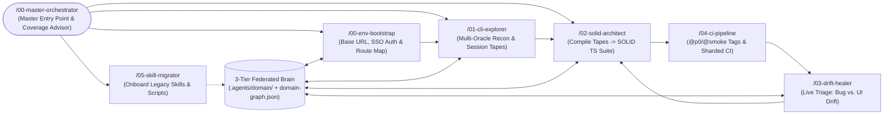
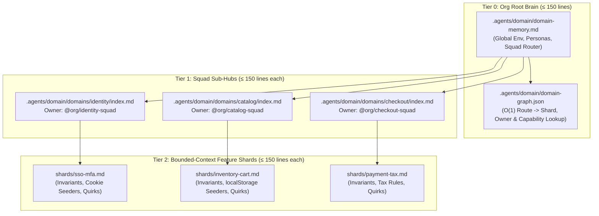

# Agentic-SOLID-QE (`agentic-solid-qe` · CLI: `cortex` / `asqe`)

> **Zero-API-key, open-source agent skill framework bridging Autonomous Exploratory Testing (`@playwright/cli`), an Enterprise 3-Tier Organizational Domain Brain (`cortex`), and SOLID Playwright TypeScript Architecture (`@playwright/test`).**

[](./LICENSE)
[](https://www.npmjs.com/package/@playwright/cli)
[](https://playwright.dev)

---

## Why `agentic-solid-qe`?

Current AI browser testing setups break down as soon as you move beyond a toy demo:
1. **MCP-based browser agents** stream heavy accessibility trees and base64 screenshots into the LLM context window on every click, burning token budgets in minutes.
2. **Flat test generators (`codegen`)** output brittle, monolithic `.spec.ts` files with hardcoded strings and inline assertions that fail enterprise PR reviews.
3. **Unstructured team prompts & scripts** trap institutional domain knowledge inside 3,000-token `.cursorrules` files or fragile relative scripts (`../helpers/seed.sh`) that cannot scale across 100+ engineers.

**`agentic-solid-qe`** solves all three using your existing IDE agent (**Google Antigravity, Claude Code, GitHub Copilot, or Cursor**) with **zero external OpenAI/Anthropic API keys**:
- **4–5x Lower Token Cost via `@playwright/cli`:** `01-cli-explorer` and `03-drift-healer` drive named browser sessions via `playwright-cli` and inspect compact `.playwright-cli/page-*.yml` disk snapshots instead of flooding LLM context.
- **3-Tier Federated Organizational Brain (`domain-graph.json`):** Domain knowledge is organized into **Tier 0 Org Global Context**, **Tier 1 Squad Sub-Hubs**, and **Tier 2 Feature Shards** (each capped at `≤ 150` lines) with an O(1) machine-readable router so 100+ engineers can build a shared institutional brain without git merge conflicts or context overflow.
- **Deterministic SOLID Compilation & Audit Gate (`npm run verify`):** `02-solid-architect` compiles verified JSON **Session Tapes** (`.exploratory/tapes/*.json`) into atomic UI Components (`≤ 150` lines, zero `expect()`), composed Pages, Liskov Contracts, `mergeTests()` Fixtures, and Typed Data Builders.
- **Turnkey Legacy Skill & Script Onboarding (`05-skill-migrator`):** Teams with existing prompts and helper scripts can run one command (`npm run migrate:skill`) to decompose them into `< 500`-token `SKILL.md` bundles, sanitized `scripts/`, `references/`, and 3-Tier Domain Shards.

---

## Master Orchestrator & Closed-Loop QE Lifecycle



### Slash Command & CLI Cheat Sheet

| Slash Command (IDE) | Backing CLI / Gate | When to Use |
| :--- | :--- | :--- |
| **`/00-master-orchestrator`** (`/master-orchestrator`) | `npx cortex orchestrate` / `npm run orchestrate` | **Start Here (Entry Point):** Understand all framework skills/features, diagnose repo maturity (`Stage 0`–`Stage 4`), select an Onboarding Track, and get the exact next step to incrementally increase automation coverage. |
| **`/00-env-bootstrap`** | `npm run init:app` | Configure target `baseUrl`, capture reusable `.auth/<persona>.json` (`storageState`) for SSO/MFA apps, and seed initial route shards. |
| **`/01-cli-explorer`** | `npm run coverage:gaps` | Explore unfamiliar multi-page flows via `@playwright/cli --headed`, audit API/console/state/a11y, log bugs to `defects/`, and curate `.exploratory/tapes/*.json`. |
| **`/02-solid-architect`** | `npm run verify` | Compile Session Tapes into SOLID Components, Pages, Contracts, Fixtures, Data Builders, and tagged `.spec.ts` files. |
| **`/03-drift-healer`** | `npx playwright test` | Diagnose failing tests against live environments via `@playwright/cli` to separate real app defects from harmless locator/flow drift. |
| **`/04-ci-pipeline`** | `npm run audit:solid` | Curate `@p0`/`@smoke`/`@regression` tags, harden `playwright.config.ts`, and scaffold sharded GitHub Actions / Azure DevOps pipelines. |
| **`/05-skill-migrator`** | `npm run migrate:skill` | Decompose unorganized team skills, `.cursorrules`, and helper scripts (`.sh`, `.js`, `.mjs`, `.ts`, `.py`) into `< 500`-token `SKILL.md` bundles and Domain Shards. |

---

## Master Orchestrator Entry Point (`/00-master-orchestrator`) & 5-Stage Incremental Coverage Progression

Whether you are a human engineer or an AI agent entering a repository for the first time, invoke **`/00-master-orchestrator`** (or `/master-orchestrator` / `npx cortex orchestrate`) as your single entry point.

### What `/00-master-orchestrator` Does Automatically
1. **Runs Live Project Diagnostics:** Executes `npm run coverage:gaps` (`npx cortex orchestrate`) and `npm run migrate:skill -- --discover`, and reads `.agents/domain/domain-memory.md` + the [Master Orchestration Playbook](./.agents/skills/00-master-orchestrator/references/master-orchestration-playbook.md).
2. **Explains All Framework Capabilities:** Maps your team's needs across all skills (`/00-env-bootstrap` through `/05-skill-migrator`), SOLID contracts (`IdentifiableComponent`, `ErrorBannerContract`, `WizardStepContract`, `ApiClientContract`), shared utilities (`AuthTokenBridge`, `RelativeDateHelper`), and the 3-Tier Federated Brain (`--squad`, `--org-brain`).
3. **Presents a Project Maturity & Next-Action Blueprint:** Classifies the repository into its **Onboarding Track (Tracks 1–4)** and current **Coverage Maturity Stage (`Stage 0`–`Stage 4`)**, and recommends the **single next command** to run.

### The 5-Stage Incremental Coverage Ladder (`1 Test at a Time`)

Instead of generating dozens of brittle tests in one unverified batch, `/00-master-orchestrator` guides users and AI agents to grow automation coverage incrementally across five deterministic stages:

| Maturity Stage | Focus & Session Tape Charters | Skills & Contracts Used | Exit Gate (`npm run verify`) |
| :--- | :--- | :--- | :--- |
| **Stage 0: Foundation, Auth & Legacy Onboarding** | Initialize or `sync` framework, migrate legacy `.cursorrules`/`CLAUDE.md`/scripts, capture SSO/MFA `.auth/<persona>.json`, and seed top-level route shards. | `/00-master-orchestrator` ➔ `/05-skill-migrator` ➔ `/00-env-bootstrap` | Valid `Base URL` in `domain-memory.md`, `.auth/*.json` captured, initial shards indexed (`npm run domain:graph`). |
| **Stage 1: P0 Golden-Path Baseline (`@p0`)** | Automate **1 `@p0` happy-path vertical slice per uncovered shard** (`charter: "happy-path-baseline"`) before writing edge cases. | `/01-cli-explorer` ➔ `/02-solid-architect <scenario>` (`IdentifiableComponent`) | `uncoveredShards.length === 0`, `uncompiledTapes.length === 0`, and `npm run test:p0` passes. |
| **Stage 2: Persona, Boundary & Resilience Expansion (`@smoke` / `@regression`)** | Layer `multi-persona-auth`, `boundary-analysis`, `state-interruption`, and `accessibility-audit` scenarios reusing Stage 1 Components and Data Builders. | `/01-cli-explorer` ➔ `/02-solid-architect <scenario>` (`ErrorBannerContract`, `UserBuilder`) | Positive + negative/boundary/persona specs pass `npm run test:smoke` with zero duplicated page objects. |
| **Stage 3: Complex Wizards, Backend APIs & Cross-Portal Handoffs** | Scale to 5–12 step conditional wizards, fast API precondition seeding, `@api-contract` tests, and multi-actor Customer ➔ Back-Office Agent flows. | `/01-cli-explorer` ➔ `/02-solid-architect` (`WizardStepContract`, `ApiClientContract`, `AuthTokenBridge`, `RelativeDateHelper`) | `unimplementedApiClients.length === 0` and all wizard/API/multi-portal specs pass `npm run verify`. |
| **Stage 4: Sharded CI/CD & Continuous Drift Healing** | Enforce `@p0`/`@smoke`/`@regression` tags in sharded CI pipelines and triage live test failures into real defects (`defects/DEFECT-*.md`) vs. healed UI/API drift. | `/04-ci-pipeline` & `/03-drift-healer` | `staleShards.length === 0`, sharded CI green, and `npm run audit:solid` passes. |

---

## Repository Architecture

```text
agentic-solid-qe/
├── .agents/
│   ├── domain/
│   │   ├── domain-memory.md           # Tier 0 Org Root Index: Global env, personas & Squad Router (<=150 lines)
│   │   ├── domain-graph.json          # Auto-compiled O(1) Route -> Shard, Owner Squad & Capability Router
│   │   ├── domains/<squad>/           # Tier 1 Squad Sub-Hubs (index.md) & Tier 2 Squad Shards (shards/*.md)
│   │   ├── shards/                    # Global / Single-Team Feature Shards (<=150 lines each)
│   │   └── session-tape.schema.json   # Strict JSON contract between Skill 01 & Skill 02
│   └── skills/
│       ├── 00-master-orchestrator/    # Master Orchestrator: Entry Point, Diagnostics & 5-Stage Coverage Advisor
│       ├── 00-env-bootstrap/          # Skill 00: Auth (storageState) & Unfamiliar App Route Discovery
│       ├── 01-cli-explorer/           # Skill 01: Multi-Page Explorer, Triage & Coverage Curator
│       ├── 02-solid-architect/        # Skill 02: SOLID Playwright TypeScript Architect
│       ├── 03-drift-healer/           # Skill 03: Live Failure Triage & Self-Healing
│       ├── 04-ci-pipeline/            # Skill 04: Regression Tagging & Sharded CI/CD Architect
│       └── 05-skill-migrator/         # Skill 05: Legacy Skill & Script Onboarding Migrator + Starter Guide
├── .github/
│   ├── copilot-instructions.md        # Auto-bridges Master Orchestrator + all lifecycle skills for Copilot
│   ├── prompts/                       # Slash prompt triggers (/00-master-orchestrator, /00..05) for Copilot
│   └── workflows/playwright-ci.yml    # Sharded GitHub Actions pipeline with SOLID gate
├── .claude/commands/                  # Slash commands (/00-master-orchestrator, /00..05) for Claude Code
├── .azure-pipelines/playwright-ci.yml # Sharded Azure DevOps pipeline template
├── defects/                           # Structured Markdown bug reports + evidence pointers
├── .exploratory/tapes/                # Validated JSON Session Tapes
├── src/                               # Reference SOLID Playwright Framework
│   ├── contracts/                     # Shared Liskov Substitution interfaces (LSP)
│   ├── shared/components/             # Org-wide Design System components <= 150 lines
│   ├── domains/<squad>/               # Squad-scoped {api, components, steps, pages, data, fixtures} modules
│   ├── components/                    # Atomic UI components <= 150 lines, zero expect() (SRP)
│   ├── pages/                         # Composed page workflows, zero expect() (SRP)
│   ├── fixtures/                      # Composable test.extend<>() / mergeTests() injection (OCP/ISP)
│   └── data/                          # Typed Data Builders — no magic strings in specs (DIP)
├── tests/                             # Declarative web-first .spec.ts suites (@p0, @smoke, @regression)
├── scripts/
│   ├── build-domain-graph.mjs         # Compiles 3-Tier Brain into .agents/domain/domain-graph.json
│   ├── migrate-skill.mjs              # Analyzer & scaffolder for onboarding legacy team skills & scripts
│   ├── analyze-coverage.mjs           # Master Orchestrator diagnostic, coverage maturity & gap analyzer
│   ├── audit-solid.mjs                # Deterministic gate enforcing <500-token skills, <=150-line shards & SOLID
│   ├── validate-tapes.mjs             # Session Tape JSON schema validator
│   └── sync-skills.mjs                # Installer, --squad scaffolder & --org-brain federated sync CLI
├── AGENTS.md                          # Universal entrypoint for Antigravity / Claude / Cursor
└── playwright.config.ts               # Production config (parallelism, retries, traces)
```

---

## AI-Guided Installation & Skill Migration Playbook (Ask Your Agent)

Any IDE AI agent (**Google Antigravity, Claude Code, GitHub Copilot, Cursor, or Windsurf**) can read this `README.md` (and [`AGENTS.md`](./AGENTS.md)) to interactively install `agentic-solid-qe` into an existing project and migrate your existing skills, prompts, and scripts under the repository's SOLID and `< 500`-token guardrails.

### Copy-Paste Prompts for Users

- **Prompt 0 — Start Here: Ask the Master Orchestrator to Diagnose & Guide Your Next Step (`/00-master-orchestrator`):**
  > *"Invoke `/00-master-orchestrator` (read `.agents/skills/00-master-orchestrator/SKILL.md` and `references/master-orchestration-playbook.md`). Run `npm run coverage:gaps` (`npx cortex orchestrate`) and `npm run migrate:skill -- --discover`, explain how all the skills and features in `agentic-solid-qe` apply to our project, show our current Coverage Maturity Stage (Stage 0–4), and recommend the single next step to incrementally increase our automation coverage."*
- **Prompt 1 — Install into an Existing Project & Discover Legacy Skills:**
  > *"Read `https://github.com/letstrnsfrm-ai/agentic-solid-qe` (`README.md` and `AGENTS.md`). Inspect my current repository, explain how `agentic-solid-qe` fits my setup, run `npx --yes github:letstrnsfrm-ai/agentic-solid-qe init .` non-destructively, and run `npm run migrate:skill -- --discover` to inventory my existing skills, prompts, scripts, and Playwright tests."*
- **Prompt 2 — Migrate Existing Skills & Scripts with Full Guardrails (`/05-skill-migrator`):**
  > *"Run `/05-skill-migrator` (`npm run migrate:skill -- --discover`), walk me through the 4-Part Migration Triage Matrix for each of my existing skills/rules/scripts, migrate them with `--apply`, and verify all guardrails pass with `npm run verify`."*
- **Prompt 3 — Upgrade an Existing `agentic-solid-qe` Consumer Repository Non-Destructively (`sync`):**
  > *"Read `https://github.com/letstrnsfrm-ai/agentic-solid-qe` (`README.md`, `AGENTS.md`, and `.agents/skills/02-solid-architect/references/complex-orchestration-guide.md`). Run `npx --yes github:letstrnsfrm-ai/agentic-solid-qe sync` (`npm run upgrade:skills`) to non-destructively update our skills, `session-tape.schema.json`, scripts, and foundational contracts/shared helpers (`WizardStepContract`, `ApiClientContract`, `AuthTokenBridge`, `RelativeDateHelper`) without modifying our existing domain shards or tests, then run `npm run verify`."*
- **Prompt 4 — Orchestrate Complex Multi-Step Wizards, Cross-Portal Handoffs & Backend APIs (1 Test at a Time):**
  > *"Read `.agents/skills/02-solid-architect/references/complex-orchestration-guide.md`. Scaffold our application domains (`npx cortex sync --squad <domain>`), explore 1 critical business flow and its backend API contracts via `/01-cli-explorer`, and compile/verify 1 test at a time via `/02-solid-architect <scenario-id>`."*

### 4-Step Execution Protocol for AI Agents Reading This File

When a user asks you (the AI Agent) to help them understand, install, upgrade, or migrate skills into `agentic-solid-qe`, execute these four steps interactively:

1. **Step 1 — Assess the Existing Project & Recommend an Onboarding Track:**
   - Inspect `package.json`, `playwright.config.ts`, `tsconfig.json`, and existing test folders (`tests/`, `e2e/`).
   - Recommend **Track 1** (single-app setup), **Track 2** (if `.cursorrules`, `.windsurfrules`, `CLAUDE.md`, `.claude/commands/`, `.github/prompts/`, or custom helper scripts exist), **Track 3** (if multiple engineering squads share the repo), or **Track 4** (for multi-step wizards, multi-portal handoffs, backend API seeding, or upgrading an existing `agentic-solid-qe` installation).
2. **Step 2 — Run Non-Destructive Initialization (`init`) or Consumer Upgrade (`sync`):**
   - For first-time setup: execute `npx --yes github:letstrnsfrm-ai/agentic-solid-qe init . --url <app-url> --name "<App Name>"`.
   - For existing consumers upgrading: execute `npx --yes github:letstrnsfrm-ai/agentic-solid-qe sync` (`npm run upgrade:skills`).
   - Both safely merge `package.json` scripts and `tsconfig.json` `@*` path aliases without deleting existing tests, seed missing foundational contracts/helpers (`src/contracts/*`, `src/shared/*`), and automatically back up any pre-existing custom `AGENTS.md` or `.github/copilot-instructions.md` into `.agents/legacy-backups/` so nothing is lost.
3. **Step 3 — Auto-Discover Legacy Skills, Prompts, Scripts & Spec Gaps (`--discover`):**
   - Execute `npm run migrate:skill -- --discover` (`npx cortex migrate --discover`).
   - Present the JSON discovery report to the user:
     - `discoveredLegacySkillsAndPrompts`: Every `.cursorrules`, `.windsurfrules`, `CLAUDE.md`, `.agents/legacy-backups/*.md`, `.cursor/rules/*.mdc`, custom `.claude/commands/*.md`, `.github/prompts/*.md`, and oversized/unregistered skill with its token count and ready-to-run migration command.
     - `existingPlaywrightSuiteAudit`: Existing `.spec.ts` files that import directly from `@playwright/test` instead of `@fixtures/app.fixture` or lack `@data/*` Data Builders.
4. **Step 4 — Run Guarded Migration (`--apply`) or 1-Test-at-a-Time Orchestration & Verification (`npm run verify`):**
   - For legacy skills/prompts, run dry-run (`npm run migrate:skill -- <path> --name <skill-id> [--squad <squad>]`), present the **4-Part Migration Triage Matrix** for user confirmation, then run with `--apply` and `npm run verify`.
   - For complex multi-step/multi-portal/API flows, follow [`.agents/skills/02-solid-architect/references/complex-orchestration-guide.md`](./.agents/skills/02-solid-architect/references/complex-orchestration-guide.md) to explore and compile **1 test at a time**.

---

## Onboarding Tracks (Choose Your Starting Point)

- **[Track 1: Greenfield / Single-App Quick Start (5 Minutes)](#track-1-greenfield--single-app-quick-start-5-minutes)** — Start from scratch or drop into an existing Playwright repo.
- **[Track 2: Onboarding Existing Team Skills & Helper Scripts (`/05-skill-migrator`)](#track-2-onboarding-existing-team-skills--helper-scripts-05-skill-migrator)** — Bring your team's existing `.cursorrules`, prompts, and `.sh`/`.js`/`.py` scripts into the framework.
- **[Track 3: Scaling to 100+ Engineers (3-Tier Federated Organizational Brain)](#track-3-scaling-to-100-engineers-3-tier-federated-organizational-brain)** — Partition domain knowledge and SOLID modules across 10–25 squads without merge conflicts.
- **[Track 4: Complex Multi-Step Wizards, Multi-Portal Handoffs, Backend APIs & Consumer Upgrades](#track-4-complex-multi-step-wizards-multi-portal-handoffs-backend-apis--consumer-upgrades)** — Orchestrate 5–12 step conditional workflows (e.g., Motor/Home Insurance), Back-Office Agent Portals, Backend API clients, and non-destructive upgrades 1 test at a time.

---

## Track 1: Greenfield / Single-App Quick Start (5 Minutes)

### 1. Install or Drop Into Your Repository

**Option A — Drop into any existing TypeScript/Playwright project (`npx`):**
```bash
npx --yes github:letstrnsfrm-ai/agentic-solid-qe init . --url https://your-app-url.com --name "Your App"
npm install
npx playwright install chromium
```

**Option B — Clone or Use as a GitHub Template:**
```bash
gh repo create my-app-e2e --template letstrnsfrm-ai/agentic-solid-qe --public --clone
cd my-app-e2e
npm install
npx playwright install chromium

# Optional: Run the pre-loaded SauceDemo reference suite
npm run verify

# Reset demo artifacts and point at your own target application
npm run init:app -- --url https://your-app-url.com --name "Your App"
```

### 2. Drive Coverage with the Master Orchestrator & Core QE Slash Commands

Open your IDE agent (**Antigravity, Claude Code, GitHub Copilot, or Cursor**) and invoke:

0. **Diagnose Repo & Get Incremental Coverage Plan (`/00-master-orchestrator`):**
   > **Prompt:** `"/00-master-orchestrator"` (or `"/master-orchestrator"`)
   - Runs `npm run coverage:gaps` (`npx cortex orchestrate`) + `npm run migrate:skill -- --discover`, reports your current **Coverage Maturity Stage (`Stage 0`–`Stage 4`)**, and recommends the exact next skill to invoke.
1. **Bootstrap Environment & SSO/MFA Session (`/00-env-bootstrap`):**
   > **Prompt:** `"/00-env-bootstrap"`
   - Launches `@playwright/cli --headed`, captures authenticated `.auth/<persona>.json` (`storageState`), and maps top-level routes into `.agents/domain/shards/*.md`.
2. **Explore & Curate Session Tapes (`/01-cli-explorer`):**
   > **Prompt:** `"/01-cli-explorer"`
   - Runs `npm run coverage:gaps`, recommends the **Top 3 Uncovered High-Risk Scenarios** (P0 `happy-path-baseline` ➔ P1 `multi-persona-auth` / `boundary-analysis` ➔ P2 `state-interruption`), explores the flow live, logs any bugs to `defects/`, and outputs QE-approved `.exploratory/tapes/<scenario>.json`.
3. **Compile Tapes into SOLID TypeScript (`/02-solid-architect`):**
   > **Prompt:** `"/02-solid-architect"`
   - Compiles uncompiled Session Tapes into `src/contracts/`, `src/components/`, `src/pages/`, `src/data/`, `src/fixtures/`, and `tests/*.spec.ts`, then runs `npm run verify`.
4. **Harden CI Tags & Sharded Pipelines (`/04-ci-pipeline`):**
   > **Prompt:** `"/04-ci-pipeline"`
5. **Heal Live Test Failures (`/03-drift-healer`):**
   > **Prompt:** `"/03-drift-healer"`

---

## Track 2: Onboarding Existing Team Skills & Helper Scripts (`/05-skill-migrator`)

Already have team skills, `.cursorrules`, `.windsurfrules`, `CLAUDE.md`, `.claude/commands`, `.github/prompts`, or ad-hoc helper scripts (`.sh`, `.js`, `.mjs`, `.ts`, `.py`) that aren't structured for `agentic-solid-qe`? Use **`/05-skill-migrator`** (backed by [`scripts/migrate-skill.mjs`](./scripts/migrate-skill.mjs) and the [Migration Starter Guide](./.agents/skills/05-skill-migrator/references/migration-starter-guide.md)).

### 1. Auto-Discover All Legacy Skills, Prompts & Spec Guardrail Gaps (`--discover`)
Scan your entire workspace to inventory unmigrated AI rules, skills, helper scripts, and existing `.spec.ts` files needing SOLID alignment:

```bash
npm run migrate:skill -- --discover
```

### 2. Run a Dry-Run Migration Scan for a Specific Skill
Point the migrator at any discovered markdown prompt or folder containing a skill and its scripts:

```bash
npm run migrate:skill -- ./path/to/legacy-skill-or-folder --name 06-billing-seeder --squad billing
```

Or inside your IDE chat:
> **Prompt:** `"/05-skill-migrator ./path/to/legacy-skill-or-folder"`

The analyzer inspects your files without modifying them and presents a **4-Part Migration Triage Matrix**:
1. **Token Budget Audit:** Compares original token count against the strict `< 500`-token `SKILL.md` cap and previews what will move to secret-sanitized `.agents/skills/<skill-id>/references/legacy-reference.md`.
2. **Script Discovery & Classification:**
   - `utility-or-api-seeder` scripts (API callers, DB seeders, schema tools) are slated for `.agents/skills/<skill-id>/scripts/` with hardcoded `http(s)://` URLs parameterized via `process.env.BASE_URL` and secrets redacted.
   - `legacy-ui-automation` scripts (raw Puppeteer/Playwright/Cypress files using `waitForTimeout` or XPath) are archived in `references/` and bridged into schema-valid **Session Tapes** (`.exploratory/tapes/<skill-id>.json`) for `/02-solid-architect`.
3. **Rewritten Root-Relative Commands:** Fragile relative invocations (`bash ../scripts/seed.sh`) are rewritten to canonical commands (`bash .agents/skills/06-billing-seeder/scripts/seed.sh`).
4. **Domain Brain Extraction & Indexing:** Embedded `/routes` and `data-testid` attributes are extracted into a `≤ 150`-line Domain Shard and indexed in `.agents/domain/domain-memory.md` (or `.agents/domain/domains/<squad>/index.md`).

### 3. Apply & Verify All Guardrails
```bash
npm run migrate:skill -- ./path/to/legacy-skill-or-folder --name 06-billing-seeder --squad billing --apply
npm run verify
```
This scaffolds `.agents/skills/<skill-id>/{SKILL.md,references/,scripts/}`, bridges any UI script into `.exploratory/tapes/<skill-id>.json`, scaffolds & indexes the `≤ 150`-line Domain Shard, registers the skill in `AGENTS.md` and `.github/copilot-instructions.md`, and creates `.claude/commands/<skill-id>.md` + `.github/prompts/<skill-id>.prompt.md` wrappers in one step.

| Legacy Pattern | `agentic-solid-qe` Guardrail Standard | Verification Gate |
| :--- | :--- | :--- |
| Monolithic prompt (`> 500` tokens) | `< 500`-token `SKILL.md` + `references/legacy-reference.md` | `npm run audit:solid` |
| Unindexed or `> 150`-line domain notes | Indexed Tier 0/1/2 Domain Shard (`≤ 150` lines) + `**Last Verified:**` | `npm run audit:solid` & `npm run domain:graph` |
| Hardcoded secrets (`sk-*`, `ghp_*`, `password=...`) | Redacted in `references/` & `scripts/`; read from `process.env` / `src/data/*.builder.ts` | `npm run audit:solid` |
| Raw UI script (`waitForTimeout`, XPath) | Archived in `references/`, bridged to `.exploratory/tapes/<id>.json`, compiled via `/02-solid-architect` | `npm run validate:tapes` & `npm run audit:solid` |
| Existing `.spec.ts` importing `@playwright/test` | Import `{ test, expect }` from `@fixtures/app.fixture` and builders from `@data/*` | `npm run audit:solid` |

---

## Track 3: Scaling to 100+ Engineers (3-Tier Federated Organizational Brain)

When 100+ engineers across 10–25 squads contribute to an Organizational Brain, a single flat `domain-memory.md` file or a single `src/fixtures/app.fixture.ts` quickly becomes a merge-conflict bottleneck. `agentic-solid-qe` scales horizontally using a **3-Tier Federated Hierarchy** and **Domain-Scoped SOLID Modules**:



### Enterprise Scaling Commands

1. **Scaffold a New Squad Sub-Hub & Isolated SOLID Domain Module (`--squad`):**
   ```bash
   node scripts/sync-skills.mjs sync --squad checkout
   ```
   - Creates `.agents/domain/domains/checkout/index.md` (`≤ 150` lines) and `.agents/domain/domains/checkout/shards/`.
   - Creates `src/domains/checkout/{components,pages,data,fixtures}/` so the Checkout squad never conflicts with other squads on `src/fixtures/app.fixture.ts` or triggers cross-squad DIP literal collisions.
   - Registers the squad sub-hub in `.agents/domain/domain-memory.md`.

2. **Sync a Shared Org Brain Across Federated Repositories (`--org-brain`):**
   ```bash
   node scripts/sync-skills.mjs sync --org-brain ../org-qe-brain --squad checkout
   ```
   - Syncs Tier 0 `.agents/domain/domain-memory.md`, `.agents/domain/domain-graph.json`, `src/contracts/`, and `src/shared/` from a central platform repository or package while preserving each squad's local shards and specs.

3. **Compile the O(1) Domain Graph & Audit Shard Freshness (`npm run domain:graph`):**
   ```bash
   npm run domain:graph
   npm run coverage:gaps
   ```
   - Compiles `.agents/domain/domain-graph.json` with `routeIndex`, `ownerSquad`, `publishedCapabilities` (reusable API/`storageState` precondition seeders for downstream squads), `codeownersRules`, and automatic TTL staleness tracking (`**Last Verified:** YYYY-MM-DD`, default 90 days via `DOMAIN_STALE_DAYS`).

---

## Track 4: Complex Multi-Step Wizards, Multi-Portal Handoffs, Backend APIs & Consumer Upgrades

For enterprise applications with 5–12 step conditional wizards (e.g., Motor/Home Insurance Quote & Buy), Back-Office Agent/Underwriting portals, and Backend Rating/Policy APIs, follow the **[Complex Application, Multi-Portal & Backend API Orchestration Guide](./.agents/skills/02-solid-architect/references/complex-orchestration-guide.md)**.

### 1. Four Enterprise Orchestration Patterns (`1 Test at a Time`)

| Pattern | Session Tape Contract | SOLID TypeScript Target (`src/`) | When to Use |
| :--- | :--- | :--- | :--- |
| **Pattern A: Conditional Multi-Step Wizards** | `semanticSteps[].conditionRef` | Atomic `≤ 150`-line step components implementing [`WizardStepContract<TRiskProfile>`](./src/contracts/wizard-step.contract.ts) + [`RelativeDateHelper`](./src/shared/data/relative-date.helper.ts) | 5–12 step Motor/Home quote flows with conditional sections (claims history, convictions, non-standard property). |
| **Pattern B: Backend API Discovery, Seeding & Contracts** | `charter: "api-contract"`, `action: "apiCall"`, `source: "apiResponseJson"`, `networkContracts.clientCandidate` | Typed `APIRequestContext` clients in `src/domains/<squad>/api/*.client.ts` implementing [`ApiClientContract`](./src/contracts/api-client.contract.ts) + [`AuthTokenBridge`](./src/shared/api/auth-token.bridge.ts) | Fast API precondition seeding (create a Quote/Policy via API before testing Agent Portal UI) or standalone API rating tests. |
| **Pattern C: Cross-Portal Multi-Actor Handoffs** | `charter: "cross-portal-handoff"`, root `actors[]`, step `actor` & `portalUrl`, `capturedVariables` | Multi-context Playwright fixtures (`browser.newContext({ storageState })`) isolating Customer B2C and Back-Office Agent sessions | End-to-end journeys spanning Customer Quote Portal ➔ `QuoteId` ➔ Back-Office Underwriter/Agent Portal approval. |
| **Pattern D: Strict 1-Test-at-a-Time Pacing** | `nextSingleScenarioToAutomate` in `npm run coverage:gaps` | Single vertical slice compiled via `/02-solid-architect <scenario-id>` and verified via `npm run verify` | Building a stable enterprise regression suite incrementally without unverified batch generation. |

### 2. How Existing Day-to-Day Consumers Receive This Update Non-Destructively

If your team already uses `agentic-solid-qe` in an existing repository, upgrade in one command without touching your existing domain shards, pages, components, builders, or `.spec.ts` files:

```bash
# Preview changes first without modifying any files:
npx --yes github:letstrnsfrm-ai/agentic-solid-qe sync --dry-run

# Apply the non-destructive upgrade:
npx --yes github:letstrnsfrm-ai/agentic-solid-qe sync
# Or via your package.json script:
npm run upgrade:skills
```

- **Automatically Updated (`overwrite: true`):** `.agents/skills/*` (including [`complex-orchestration-guide.md`](./.agents/skills/02-solid-architect/references/complex-orchestration-guide.md)), `.agents/domain/session-tape.schema.json`, `scripts/*.mjs`, `AGENTS.md` (with automatic backup of any custom file to `.agents/legacy-backups/`), `.github/copilot-instructions.md`, `.github/prompts/*`, and `.claude/commands/*`.
- **Seeded Only If Missing (`overwrite: false`):** [`src/contracts/api-client.contract.ts`](./src/contracts/api-client.contract.ts), [`src/contracts/wizard-step.contract.ts`](./src/contracts/wizard-step.contract.ts), [`src/shared/api/auth-token.bridge.ts`](./src/shared/api/auth-token.bridge.ts), and [`src/shared/data/relative-date.helper.ts`](./src/shared/data/relative-date.helper.ts).
- **Non-Destructively Merged (JSONC-Safe):** `@domains/*` and `@shared/*` path aliases in `tsconfig.json` (even if your `tsconfig.json` uses `//` comments or trailing commas) and verification scripts in `package.json`.
- **100% Preserved:** `.agents/domain/domain-memory.md`, `.agents/domain/shards/*.md`, `.agents/domain/domains/**`, `.exploratory/tapes/*.json`, `defects/*.md`, `src/{components,pages,data,fixtures,domains}/**`, and `tests/**/*.spec.ts`.

---

## Quality Gates & Verification Scripts

| Command (`npm run` or `npx cortex` / `npx asqe`) | Description |
| :--- | :--- |
| `npm run verify` | **Full Gate:** Runs `typecheck` + `domain:graph` + `audit:solid` + `validate:tapes` + `test:engine` + `playwright test`. |
| `npx cortex orchestrate` / `npm run orchestrate` | **Master Orchestrator Snapshot:** Outputs `coverageMaturityStage` (Stage 0–4), uncovered/stale shards, uncompiled Session Tapes, API contracts, and recommended next skill (`npx cortex status`). |
| `npm run test:engine` | Runs zero-browser `node --test` self-tests verifying `--dry-run`, legacy consumer `sync` upgrades, JSONC `tsconfig.json` merging, and `--seed-from-tapes` auto-indexing. |
| `npx cortex init --url <url> --name "<App>" [--dry-run]` | Initializes or resets a repository with a clean SOLID skeleton (`npm run init:app`). |
| `npx cortex sync [--squad <squad>] [--org-brain <path>] [--dry-run]` | Upgrades skills/schema/contracts non-destructively, scaffolds a Tier 1 Squad Sub-Hub & `src/domains/<squad>/` module, or syncs an Org Brain. |
| `npx cortex migrate --discover` | Inventories legacy AI rules (`.cursorrules`, `CLAUDE.md`, backups), skills, helper scripts, and non-SOLID `.spec.ts` files. |
| `npx cortex migrate <path> [--name <id>] [--apply]` | Analyzes and scaffolds legacy team skills, prompts, and helper scripts (`npm run migrate:skill`). |
| `npx cortex graph` / `npm run domain:graph` | Compiles `.agents/domain/domain-graph.json` (routes, squad owners, published capabilities, stale shards). |
| `npx cortex gaps` / `npm run coverage:gaps` | Outputs JSON snapshot of uncovered shards, stale shards, uncompiled Session Tapes, and recommended next skill. |
| `npx cortex audit` / `npm run audit:solid` | Enforces `< 500`-token skills, `≤ 150`-line hubs/shards/components, zero `expect()` in `src/`, LSP contracts, and scoped DIP builders. |
| `npm run validate:tapes` | Validates all `.exploratory/tapes/*.json` files against `.agents/domain/session-tape.schema.json`. |
| `npm run upgrade:skills` | Upgrades core skills, scripts, and missing contracts from `github:letstrnsfrm-ai/agentic-solid-qe` while preserving your domain brain. |

---

## License

MIT © Agentic-SOLID-QE Contributors
